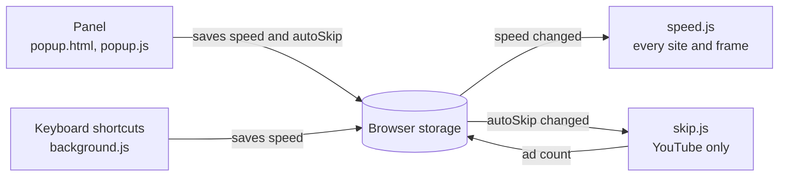

# SkipSpeed

A small extension for Chrome and Microsoft Edge (version 105 or later) that does two jobs:

- **Skips YouTube ads.** It presses Skip as soon as the button appears.
- **Controls video speed.** It plays video on any website at 0.25× to 4.5×.

There is no account or setup beyond loading the folder, and the extension makes no network requests.


## Contents

- [Install](#install)
- [Use SkipSpeed](#use-skipspeed)
- [Good to know](#good-to-know)
- [Troubleshooting](#troubleshooting)
- [Update or remove](#update-or-remove)
- [Permissions and privacy](#permissions-and-privacy)
- [How it works](#how-it-works)
- [Develop and maintain](#develop-and-maintain)
- [Credits](#credits)

## Install

SkipSpeed is installed from a folder. You need the `skipspeed` folder, unzipped, in a place you will keep it. The browser reads the extension from that folder every time it runs, so moving or deleting the folder breaks the extension.

The screenshots show Chrome. Edge follows the same steps, using `edge://` addresses, though its layout differs slightly.

### 1. Open the extensions page

Type `chrome://extensions` in the address bar. In Edge, type `edge://extensions`. Then switch on **Developer mode**.


### 2. Load the folder

Click **Load unpacked**, then choose the `skipspeed` folder. It is the one with `manifest.json` directly inside it. Choose the folder itself, not the zip file.


### 3. Check that it loaded

A SkipSpeed card appears, and its blue switch should be on. The small badge on the icon just marks a folder you loaded yourself.


### 4. Pin it to the toolbar

Click the puzzle piece, then the pin beside SkipSpeed. The icon now stays next to the address bar.

The "No access needed" heading in this menu appears because `chrome://` pages are closed to all extensions. It does not reflect what SkipSpeed can do on ordinary websites.


SkipSpeed starts working in a tab when that tab loads, so refresh any video pages that were already open.

## Use SkipSpeed

### 5. Open SkipSpeed and learn the controls

Click the SkipSpeed icon on any page. Everything is in this one small panel.


| Control | What it does |
| --- | --- |
| Large number | Shows the current speed. It gets bolder and wider as the speed rises. |
| Slider | Sets any speed from 0.25× to 4.5×, in steps of 0.05×. |
| Presets | Jump to 1×, 1.5×, 2×, 3×, 4× or 4.5×. |
| Skip YouTube ads | Turns ad skipping on or off. It is on by default. |
| Ad count | Shows how many ads SkipSpeed has skipped. It stays hidden until the first one. |
| Shortcut list | Shows the default keyboard shortcuts. |

### 6. Set a speed

Click **2×**, and the video changes at once. A badge flashes on the video to confirm the speed. The speed stays until you change it, and it applies in every tab.


### 7. Change speed from the keyboard

You don't need to open the panel. Each press moves the speed by 0.25×.

| Action | Shortcut |
| --- | --- |
| Faster | `Alt` + `Shift` + `.` |
| Slower | `Alt` + `Shift` + `,` |
| Normal speed (1×) | `Alt` + `Shift` + `0` |

On a Mac, `Alt` is the `Option` key.

Shortcuts always land on a multiple of 0.25×. If the slider left the speed at 1.1×, Faster goes to 1.25× and Slower goes to 1×.


### 8. Let ads skip themselves

There is nothing to click. Ads play at normal speed. When the Skip button appears, SkipSpeed presses it within about 0.2 seconds, and your video returns at your speed.

Ad skipping works on `www.youtube.com`, `m.youtube.com`, `music.youtube.com` and `www.youtube-nocookie.com`, including YouTube players embedded in other sites.


### 9. Turn ad skipping off

Untick **Skip YouTube ads** if you want to choose yourself. The Skip button then stays for you to click. Video speed still works.


### 10. Change a shortcut if it clashes

If a shortcut clashes with something else, open `chrome://extensions/shortcuts`. In Edge, open `edge://extensions/shortcuts`. Click the pencil and press your new keys.

This page also lists **Activate the extension**, which has no shortcut by default. Set one if you want a key that opens the panel. The shortcut list inside the panel always shows the defaults, so it will not reflect your changes.


## Good to know

- **At 1× the extension leaves the page alone.** The site's own speed menu works as usual. At any other speed, SkipSpeed overrides that menu.
- **There is one speed for everything.** It applies to every tab and frame, and there are no per-site settings.
- **Only skippable ads are skipped.** Ads with no Skip button play to the end. Ads never play sped up. SkipSpeed puts them back to 1×, then restores your speed afterwards, which can take up to a second.
- **Video calls are not sped up.** Live broadcasts are left alone when the player reports an endless duration. A live player that reports a fixed duration can't be told apart from ordinary video.
- **A player can win.** Some players reset their speed every time it changes. SkipSpeed stops pushing back after 20 tries in a second, and tries again a second later.
- **Browser pages are off limits.** No extension can change `chrome://` pages or the extension stores.
- **The ad count is a count of presses.** It goes up each time SkipSpeed presses Skip, and it is kept per browser.

## Troubleshooting

| Problem | Try this |
| --- | --- |
| Nothing happens on a video | Refresh the page. Check that the SkipSpeed switch is on at `chrome://extensions`. |
| Speed changes, then jumps back | The player is probably resetting its own speed. See "A player can win" above. |
| The panel number and the video disagree | You may have moved the slider too much too quickly. See the note below. |
| A shortcut does nothing | Open `chrome://extensions/shortcuts` and check the key is set. Another extension may already use it. |
| Ads are not being skipped | Check the **Skip YouTube ads** box. Ads with no Skip button can't be skipped. If skippable ads are missed, see [Fix ad skipping](#fix-ad-skipping). |
| It doesn't work in a private window | Open **Details** on the SkipSpeed card and turn on **Allow in Incognito**. In Edge, it is **Allow in InPrivate**. |
| It doesn't work on local video files | Open **Details** and turn on **Allow access to file URLs**. |
| "Manifest file is missing or unreadable" | You chose the wrong folder. Pick the one with `manifest.json` directly inside it. |
| SkipSpeed vanished or shows an error after moving the folder | Remove it, then load the folder again from its new location. |

**The slider limit.** The browser allows 120 saves of synced settings per minute, and each small slider movement counts as one. After a long drag, further changes can fail to save for up to a minute. The panel can then show one speed while the video plays at another. Wait a minute, then choose the speed again. Presets and shortcuts are the safer choice for repeated changes.

## Update or remove

**To update:** replace the files in the same folder, click the reload arrow on the SkipSpeed card, then refresh any open video tabs. Tabs left open keep running the old copy.

**To remove:** click **Remove** on the SkipSpeed card, then delete the folder.

**To reset the ad count:** right-click inside the panel, choose **Inspect**, open the **Console** tab and run:

```js
chrome.storage.local.remove("adsSkipped");
```

## Permissions and privacy

| Requested in `manifest.json` | Why |
| --- | --- |
| `storage` | Saves your speed, the ad skipping setting and the ad count. |
| Content script on all sites | `speed.js` has to run on any site that plays video, so the browser reports site access to all websites. |
| Content script on YouTube | `skip.js` finds and presses the Skip button. |

SkipSpeed has no servers, analytics or remote code, and it makes no network requests of its own.

Your settings are stored by the browser:

| Setting | Stored in | Default |
| --- | --- | --- |
| `speed` | `chrome.storage.sync` | `1` |
| `autoSkip` | `chrome.storage.sync` | `true` |
| `adsSkipped` | `chrome.storage.local` | `0` |

The speed and ad skipping settings use synced storage, so if browser sync is on, your browser carries them across devices on your account. The ad count stays on one device.

## How it works



The parts never message each other directly. Each one reads and writes browser storage and reacts to changes.

### Video speed (`speed.js`)

1. It runs at `document_start` in every frame of every site.
2. It finds videos in the page, including those inside open and closed shadow roots. It watches for new ones, scanning at most once a second, and also catches `play` and `loadedmetadata` events.
3. It sets `playbackRate` and `defaultPlaybackRate` on each video. It does this again on `ratechange`, `loadedmetadata` and `play`, and in a sweep every second.
4. It skips video calls and live streams (`srcObject` set, or a duration of `Infinity`).
5. It holds YouTube ads (`.ad-showing`, `.ad-interrupting`) at 1×.
6. When the speed changes, it shows a badge on the first visible video for 0.9 seconds.

A video the extension has never changed is left alone at 1×, which is how the site's own speed menu stays in charge.

### Ad skipping (`skip.js`)

Every 200 ms, while ad skipping is on:

1. It looks for a player in an ad.
2. It looks for a visible, enabled Skip button. If `SKIP_SELECTORS` finds nothing, it falls back to any button in the ad layer that is named like a skip button, has no digits in its text and isn't a preview or countdown.
3. It presses the button with a full pointer and mouse sequence, then adds one to the ad count.
4. If the same ad is still running 350 ms later, it seeks the ad to its end. YouTube can ignore script clicks (`event.isTrusted` is false), so this reaches the same result.

Nothing happens until a real Skip button is visible, so ads without one are never cut short.

### Keyboard shortcuts (`background.js`)

The service worker receives each command, moves the stored speed to the next multiple of 0.25×, and keeps it between 0.25× and 4.5×. The content scripts pick up the new value from storage.

## Develop and maintain

There is no build step and there are no dependencies. Edit the files, then reload.

### Project layout

```text
skipspeed/
├── manifest.json     Extension settings, permissions, shortcuts
├── background.js     Keyboard shortcut handling
├── speed.js          Video speed, runs on all sites
├── skip.js           Ad skipping, runs on YouTube only
├── popup.html        Panel markup
├── popup.css         Panel styles, light and dark
├── popup.js          Panel behaviour
├── icons/            Toolbar and store icons (16, 32, 48, 128 px)
├── fonts/            Bricolage Grotesque and its licence
├── docs/guide/       Screenshots used in this README
└── README.md
```

### Work on the code

1. Load the folder as described in [Install](#install).
2. Edit a file.
3. Click the reload arrow on the SkipSpeed card.
4. Refresh the test page. Scripts in tabs left open stop being able to reach the extension.

To see errors, click **service worker** on the card for `background.js`, right-click the panel and choose **Inspect** for the panel, and use the page's DevTools console for `speed.js` and `skip.js`.

### Tune it

| Value | File | Default | Effect |
| --- | --- | --- | --- |
| `MIN_SPEED`, `MAX_SPEED` | `background.js`, `popup.js` | 0.25, 4.5 | Speed range. Also update `min` and `max` on the slider in `popup.html`. |
| `STEP` | `background.js` | 0.25 | Shortcut step. |
| `PRESETS` | `popup.js` | 1, 1.5, 2, 3, 4, 4.5 | Preset buttons. |
| `POLL_MS` | `skip.js` | 200 | How often to look for a Skip button. |
| `SEEK_AFTER_MS` | `skip.js` | 350 | Wait after pressing before seeking the ad to its end. |
| `SKIP_SELECTORS` | `skip.js` | See file | Names of YouTube's Skip button. |
| `SWEEP_MS` | `speed.js` | 1000 | How often to reapply the speed. |
| `SCAN_GAP_MS` | `speed.js` | 1000 | Shortest gap between page scans. |
| `MAX_CORRECTIONS_PER_SECOND` | `speed.js` | 20 | When to stop fighting a player that resets its speed. |

If you change a default shortcut in `manifest.json`, also update the list in `popup.html` and the table in this file. Browsers may keep the old key for an installed extension, so remove and reload it to test.

### Fix ad skipping

YouTube renames its player elements from time to time.

1. Open a YouTube video and wait for an ad with a Skip button.
2. Right-click the button and choose **Inspect**.
3. Add its class or ID to `SKIP_SELECTORS` at the top of `skip.js`. Put new names first.
4. Check that `PLAYER_IN_AD` still matches the player during an ad.
5. Reload the extension and refresh YouTube.

### Check a change

There are no automated tests, so run through this list before a release:

- [ ] The extension loads with no errors on the extensions page.
- [ ] Presets, the slider and all three shortcuts change the speed, and the badge appears.
- [ ] The speed reaches a second open tab.
- [ ] At 1×, the site's own speed menu works.
- [ ] Shortcuts stop at 0.25× and 4.5×.
- [ ] On YouTube, a skippable ad is skipped, the count goes up and the video returns at your speed.
- [ ] An ad with no Skip button plays through at 1×.
- [ ] With the box unticked, the Skip button waits for a click.
- [ ] A video call isn't sped up.
- [ ] The panel looks right in light and dark mode.

### Package a release

1. Raise `version` in `manifest.json`.
2. Zip the `skipspeed` folder itself, so it unzips with `manifest.json` one level down.

On Windows PowerShell, from the folder above `skipspeed`:

```powershell
Compress-Archive -Path skipspeed -DestinationPath skipspeed-1.0.0.zip
```

## Credits

The panel uses Bricolage Grotesque, under the SIL Open Font License (`fonts/OFL.txt`).
